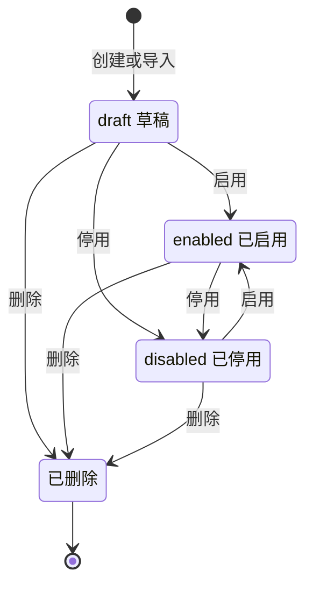
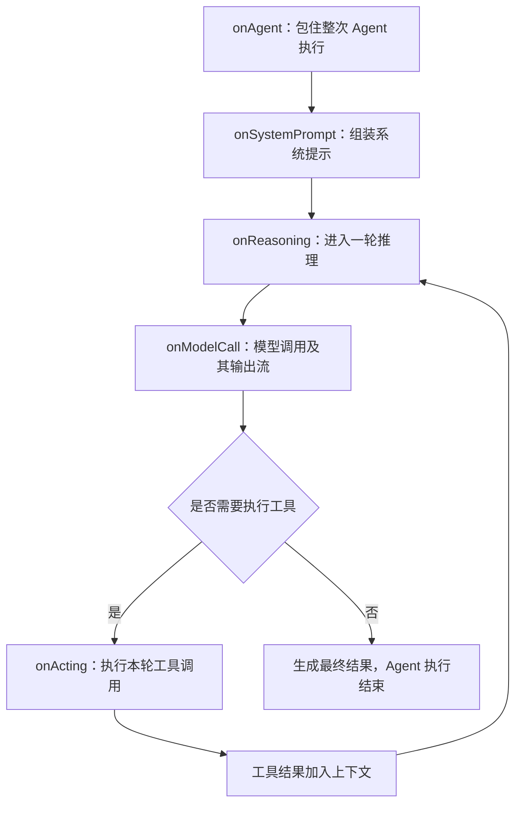
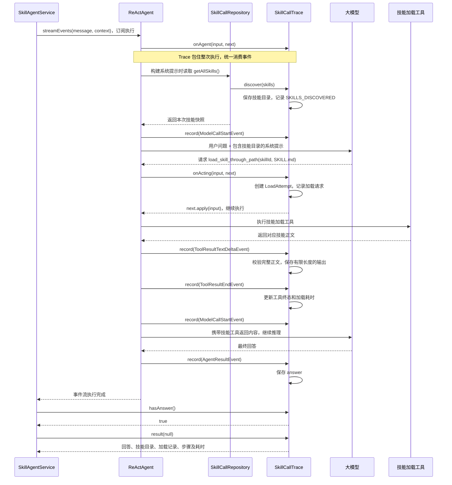

# 个人技能

## 前言

个人技能的设计可以分成四组：

| 分组 | 字段 | 为什么需要 |
|---|---|---|
| 身份和归属 | `id`、`tenant_id`、`owner_user_id` | 确定是哪条记录、属于哪个租户和用户 |
| 技能内容 | `name`、`description`、`instructions_md` | 支持模型发现技能、加载指令 |
| 扩展信息 | `extra_frontmatter` | 保存其他 YAML 属性，避免每增加一种属性就改表结构 |
| 管理信息 | `status`、`revision`、创建及更新时间 | 控制可用性、处理并发修改、展示维护情况 |

其中有两个细节：
- 同一租户、同一用户下，`name` 唯一；不同用户可以拥有同名技能。
- extra_frontmatter 不允许重复保存 name、`description`，避免同一属性出现两个不同的值。
 
把内容存进数据库，也让分页、归属过滤、唯一性约束和版本条件更新可以放在同一套持久化机制里完成。

归属限制贯穿业务调用，而不是只在 Controller 检查一次。

创建时，Service 根据 scope 填写归属；读取和修改时，把归属条件带进 SQL。例如详情查询实际上要求：

```sql
WHERE id = :skillId
  AND tenant_id = :tenantId
  AND owner_user_id = :userId
```

状态负责控制“是否提供给 Agent”，技能创建和导入后都从草稿开始：





管理接口可以查看自己的各种状态；框架仓库只暴露 `enabled`。

所以我们需要开发如下功能


| 步骤 | 要完成什么 | 完成标准 |
|---|---|---|
| **1. 验证数据库读写** | 验证现有 Entity、Mapper、TypeHandler 和枚举映射 | 一条技能能保存并完整读回，主键、JSONB、状态、时间戳都正确 |
| **2. 补最小 Service** | 先实现“创建草稿”和“查询详情”，建立租户、用户范围限制 | 用户 A 能创建和读取自己的技能；用户 B 用同一个 ID 查不到 |
| **3. 补技能管理** | 逐个增加列表、编辑、启用、停用、删除；处理 `revision` 和更新时间 | 旧版本编辑不会覆盖新内容；所有操作都限定数据归属 |
| **4. 接入 SKILL.md 导入** | 解析文件头和正文，校验后调用创建服务；第一版导入为草稿 | 一份合法文件能入库；缺少名称、描述或正文时能明确说明原因 |
| **5. 接通数据库与 Skill Repository** | 将个人技能记录转换为框架能使用的技能，按当前身份提供已启用记录 | 仓库能列出和加载当前用户的技能，草稿和停用技能不参与 |
| **6. 跑通一次 Agent 调用** | 将仓库挂载到 Agent，观察技能发现、正文加载和回答过程 | 能从调用记录确认选中了哪个技能，并加载了对应指令 |
| **7. 验证多用户与变更生效** | 使用两个用户交替、并发调用；检查技能、会话及运行资源隔离 | A、B 不串技能和对话；修改或停用后，下一次请求使用新的状态 |
| **8. 接入 Web 入口** | 为已完成的能力增加必要接口，把认证身份传给 Service 和技能仓库 | 能通过 Web 完成导入、管理和对话，客户端不能通过修改用户 ID 越权 |

## 表设计

```sql
CREATE TABLE public.personal_skill
(
    -- 主键
    id              bigint GENERATED BY DEFAULT AS IDENTITY PRIMARY KEY,

    -- 数据归属，由服务端根据当前登录身份设置
    tenant_id       bigint        NOT NULL,
    owner_user_id   bigint        NOT NULL,

    -- 技能标识，例如 spring-code-review
    name            varchar(64)   NOT NULL,

    -- 面向模型的描述：技能的用途和适用场景
    description     varchar(1024) NOT NULL,

    -- SKILL.md 的 Markdown 正文，不包含 YAML 头部
    instructions_md text          NOT NULL,

    -- YAML 头部的其他属性，不重复存储 name、description
    extra_frontmatter jsonb NOT NULL DEFAULT '{}'::jsonb,

    -- draft：草稿；enabled：启用；disabled：停用
    status          varchar(16)   NOT NULL DEFAULT 'draft',

    -- 乐观锁版本号，每次修改递增，不表示保留历史版本
    revision        bigint        NOT NULL DEFAULT 1,

    created_at timestamptz NOT NULL DEFAULT CURRENT_TIMESTAMP,
    updated_at timestamptz NOT NULL DEFAULT CURRENT_TIMESTAMP,

    -- 同一租户、同一用户下，技能名称唯一
    CONSTRAINT uq_personal_skill_name
        UNIQUE (tenant_id, owner_user_id, name),

    -- 名称由小写英文字母、数字和单个连字符组成
    CONSTRAINT ck_personal_skill_name
        CHECK (name ~ '^[a-z0-9]+(-[a-z0-9]+)*$'
) ,

    -- 描述与正文不能为空白
    CONSTRAINT ck_personal_skill_content
        CHECK (
            btrim(description) <> ''
            AND btrim(instructions_md) <> ''
        ),

    -- 扩展头部必须为 JSON 对象，且不能包含已独立存储的字段
    CONSTRAINT ck_personal_skill_frontmatter
        CHECK (
            jsonb_typeof(extra_frontmatter) = 'object'
            AND NOT (
                extra_frontmatter ?| ARRAY['name', 'description']
            )
        ),

    CONSTRAINT ck_personal_skill_status
        CHECK (status IN ('draft', 'enabled', 'disabled')),

    CONSTRAINT ck_personal_skill_revision
        CHECK (revision > 0)
);

-- 查询当前用户已启用的技能
CREATE INDEX idx_personal_skill_enabled ON public.personal_skill (tenant_id, owner_user_id) WHERE status = 'enabled';

COMMENT ON TABLE public.personal_skill     IS '个人技能定义表，一行表示一个租户下某个用户拥有的一份技能';
```

## SKILL agent 设计

### MiddlewareBase 

首先了解一下 `MiddlewareBase` ，`MiddlewareBase` 有 5 个执行钩子和 1 个排序方法。
它们分别包住 Agent 执行的不同阶段，并不是每次请求都固定依次调用一遍。

先看完整关系，下面表示一次正常执行的阶段顺序：


其中 `onModelCall` 在正常推理流程中位于 `onReasoning` 内部；`onAgent` 则包住整个过程。

每个方法的触发时机，可以先看这张表。

| 方法 | 什么时候调用 | 一次正常 Agent 执行中的次数 |
|---|---|---|
| `order()` | 构建 Agent、排序 middleware 时读取 | 排序配置，不是执行阶段回调 |
| `onAgent(...)` | 进入整次 Agent 调用的外层执行链 | 通常 1 次 |
| `onSystemPrompt(...)` | 调用开始，生成本次系统提示词时 | 通常 1 次 |
| `onReasoning(...)` | 每次进入模型推理阶段时 | 多轮推理会多次调用 |
| `onModelCall(...)` | 进入实际模型调用及输出处理阶段时 | 通常每轮推理 1 次，也有其他调用路径 |
| `onActing(...)` | 进入工具执行阶段时 | 没有工具调用则不会进入普通工具执行路径 |

### SkillCallTrace

技能调用记录器，在 Agent 执行过程中不断积累状态，最后生成一份调用记录。

创建时，只初始化空状态，没有开始调用模型。
```java 
String callId = UUID.randomUUID().toString();
SkillCallTrace trace = new SkillCallTrace(callId);
```

此时状态相当于：
```text
callId      = 本次生成的 UUID
discovered  = {}
loads       = []
pending     = {}
steps       = []
modelCalls  = 0
answer      = null
exceeded    = false
```
构造方法本身只保存 callId，集合在字段声明处完成初始化。此时没有查询数据库、没有发现技能，也没有执行工具。
```java
// 入口一：仓库读取时，记录技能目录
new SkillCallRepository(repository, trace);

// 入口二：工具执行前，通过 middleware 记录请求
.middleware(trace);

// 入口三：Agent 事件到达时，记录执行结果
.doOnNext(trace::record);
```

入口一 会调用 `trace.discover(skills);`

```java
// 替换当前目录
discovered.clear();      
// 保存完整技能对象
discovered.put(skill.getSkillId(), skill);
// 追加发现步骤
step("SKILLS_DISCOVERED", null);            
```

这里保存完整 `AgentSkill`，是因为后面还需要用技能正文核对工具输出。

此时只表示“这些技能提供给了框架”。不能据此认定模型选择了某个技能，更不能认定正文已加载。

模型决定调用技能工具时，才进入 `onActing()`。

`onActing() ` 会：
1. 检查工具名称，只处理 `load_skill_through_path`。
2. 提取实际的 `toolCallId`、`skillId`、`path`。
3. 创建 `LoadAttempt`，初始状态为 `RUNNING`，输出为空。
4. 同时放入 `loads` 和 `pending`。
5. 记录 `SKILL_LOAD_REQUESTED`。
6. 调用 `next.apply(input)`，继续后续 `middleware` 和工具执行。


这里三个 ID 的用途不同：

```text
callId      → 标识整次请求
skillId     → 标识要加载的技能
toolCallId  → 标识某一次加载动作
```
同一个技能加载两次，`skillId` 相同，但 `toolCallId` 不同，因此会留下两条加载记录。


```java
return Flux.defer(() -> {
    return next.apply(input);
});
```

作用是延迟到订阅时才记录，避免只构造事件流、尚未执行，就提前产生“请求加载技能”的记录。当前 Service 最后的 .block() 会订阅这条执行链并等待结束。

执行过程中，`record()` 根据事件逐步补全状态。

Agent 发出的事件交给 `record()` 方法 。它只处理下面几类：

| 事件 | 内部更新 |
|---|---|
| `ModelCallStartEvent` | `modelCalls++`，追加 `MODEL_CALL` |
| `ToolResultTextDeltaEvent` | 用 `toolCallId` 找到 `pending` 中的尝试，拼接输出 |
| `ToolResultEndEvent` | 从 `pending` 移除，保存实际终态，追加 `SKILL_LOAD_FINISHED` |
| `ExceedMaxItersEvent` | 设置 `exceeded = true`，追加 `MAX_ITERS` |
| `AgentResultEvent` | 保存最终文本到 `answer`，追加 `ANSWER` |


最后，`synchronized` 是为了让这些入口安全地更新同一份状态。

仓库回调、`middleware` 和事件流回调可能运行在不同线程，所以 `discover()`、`record()`、`result()` 等方法使用同一个实例锁；`onActing()` 也在锁内更新集合。

但 `next.apply(input)` 放在锁外：只在修改记录时持锁，工具执行过程不占用这把锁。每次请求又有独立的 `trace`，因此这把锁只保护本次调用的记录。





```shell
/Users/laoshiren/laoshiren/demo/agent-scope-study/general-skills/
├── pom.xml                              # Maven 模块配置：依赖、编译和 Spring Boot 启动配置
├── README.md                            # 项目说明：技能设计、表结构、Middleware 和调用追踪
└── src/
    ├── main/
    │   ├── java/com/laoshiren/agent/
    │   │   ├── GSApp.java                # Spring Boot 应用启动入口
    │   │   ├── typehandler/
    │   │   │   └── JsonbTypeHandler.java # MyBatis 类型转换：Java Map ↔ PostgreSQL JSONB
    │   │   └── skills/
    │   │       ├── controller/           # HTTP 接口入口：接收参数、构造身份范围、调用服务
    │   │       │   ├── PersonalSkillController.java
    │   │       │   │                     # 技能增删改查、启停，以及仓库列表和加载接口
    │   │       │   ├── PersonalSkillImportController.java
    │   │       │   │                     # 接收 multipart 文件上传，调用技能导入服务
    │   │       │   ├── SkillAgentController.java
    │   │       │   │                     # 接收用户提问，返回 Agent 回答和本次调用记录
    │   │       │   └── PersonalSkillExceptionHandler.java
    │   │       │                         # 统一异常响应：参数错误、查不到、版本冲突、调用失败等
    │   │       ├── param/                # 输入参数与身份范围对象
    │   │       │   ├── CreateSkillDraft.java
    │   │       │   │                     # 创建草稿的内容：名称、描述、正文、扩展元数据
    │   │       │   ├── UpdateSkill.java
    │   │       │   │                     # 编辑技能的内容，以及客户端持有的 revision
    │   │       │   ├── SkillRevision.java
    │   │       │   │                     # 启用、停用时提交的版本号，防止旧操作覆盖新状态
    │   │       │   ├── SkillListQuery.java
    │   │       │   │                     # 列表查询参数：页码、每页数量、状态筛选
    │   │       │   ├── SkillScope.java
    │   │       │   │                     # tenantId + userId，明确本次操作的数据归属范围
    │   │       │   └── SkillAgentCall.java
    │   │       │                         # Agent 调用请求：用户消息及参数校验
    │   │       ├── result/               # 返回给调用方的数据结构
    │   │       │   ├── PersonalSkillPage.java
    │   │       │   │                     # 分页结果：页码、每页数量、总数、技能列表
    │   │       │   └── SkillAgentCallResult.java
    │   │       │                         # Agent 回答、状态、模型调用次数、技能发现与加载记录、
    │   │       │                         # 事件步骤、耗时，以及是否观察到工具终态
    │   │       ├── entity/
    │   │       │   └── PersonalSkill.java
    │   │       │                         # 数据库实体：归属、技能内容、状态、revision、时间等
    │   │       ├── enums/
    │   │       │   └── PersonalSkillStatus.java
    │   │       │                         # 技能状态：DRAFT 草稿、ENABLED 启用、DISABLED 停用
    │   │       ├── service/              # 技能业务规则
    │   │       │   ├── IPersonalSkillService.java
    │   │       │   │                     # 定义技能管理、详情查询和已启用技能查询的服务接口
    │   │       │   ├── SkillImportService.java
    │   │       │   │                     # 校验上传文件大小与 UTF-8 编码，解析后调用创建草稿服务
    │   │       │   └── impl/
    │   │       │       └── PersonalSkillServiceImpl.java
    │   │       │                         # 实现管理业务：数据校验、身份范围、事务、状态变更，
    │   │       │                         # 并区分“记录不存在”和“revision 冲突”
    │   │       ├── mapper/
    │   │       │   └── PersonalSkillMapper.java
    │   │       │                         # 数据库 SQL：带归属条件查询；修改时检查并递增 revision；
    │   │       │                         # 删除时同样校验归属和版本
    │   │       ├── parser/
    │   │       │   └── SkillMarkdownParser.java
    │   │       │                         # 解析 SKILL.md 的 YAML 文件头和 Markdown 正文，
    │   │       │                         # 校验名称、描述、正文，转换成 CreateSkillDraft
    │   │       ├── repository/           # 将业务数据库中的技能适配到 AgentScope 框架
    │   │       │   ├── PersonalSkillRepositoryFactory.java
    │   │       │   │                     # 根据 SkillScope 创建绑定当前租户、用户的仓库实例
    │   │       │   └── PersonalSkillRepository.java
    │   │       │                         # 实现 AgentSkillRepository：读取当前范围内已启用记录，
    │   │       │                         # 将 PersonalSkill 转为框架 AgentSkill；只提供读取能力
    │   │       ├── agent/                # Agent 的组装、运行和调用观察
    │   │       │   ├── SkillAgentProperties.java
    │   │       │   │                     # 绑定 skills.agent 配置：模型地址、名称、密钥、
    │   │       │   │                     # 最大迭代次数和超时时间
    │   │       │   ├── SkillAgentModelProvider.java
    │   │       │   │                     # 提供模型实例的接口，便于延迟初始化和测试替换
    │   │       │   ├── SkillAgentConfiguration.java
    │   │       │   │                     # Spring 装配模型提供者，按需创建 OpenAI 兼容模型客户端
    │   │       │   ├── SkillAgentService.java
    │   │       │   │                     # 编排一次完整调用：准备模型、仓库、临时目录和 Agent，
    │   │       │   │                     # 执行消息、处理超时与异常、返回记录并清理资源
    │   │       │   ├── SkillCallRepository.java
    │   │       │   │                     # 保存单次调用开始时读取的技能快照，保持本次内容一致，
    │   │       │   │                     # 并在框架读取技能目录时记录发现事件；不存储调用日志
    │   │       │   └── SkillCallTrace.java
    │   │       │                         # Middleware：观察 Agent 事件和工具执行，
    │   │       │                         # 关联加载请求与结果，记录回答、步骤、耗时和终态观察情况
    │   │       └── exception/
    │   │           ├── SkillNotFoundException.java
    │   │           │                     # 技能不存在或不属于当前身份范围，统一按查不到处理
    │   │           ├── SkillRevisionConflictException.java
    │   │           │                     # 客户端版本过旧，修改或删除发生乐观锁冲突
    │   │           └── SkillAgentCallException.java
    │   │                                 # Agent 调用失败，携带响应状态和已收集的部分调用记录
    │   └── resources/
    │       ├── application.yaml          # 公共运行配置：端口、数据库、上传限制、MyBatis、Agent
    │       ├── application-dev.yaml      # dev 环境的数据库连接配置覆盖
    │       └── db/
    │           └── schema.sql            # personal_skill 建表 SQL、字段约束、归属内名称唯一约束、
    │                                     # 状态与版本约束，以及已启用技能查询索引
    └── test/
```

这里最容易混淆的三个文件是：`PersonalSkillRepository` 负责从数据库提供技能，`SkillCallRepository` 负责固定一次调用使用的技能快照，`SkillCallTrace` 负责记录这次调用实际发生了什么。