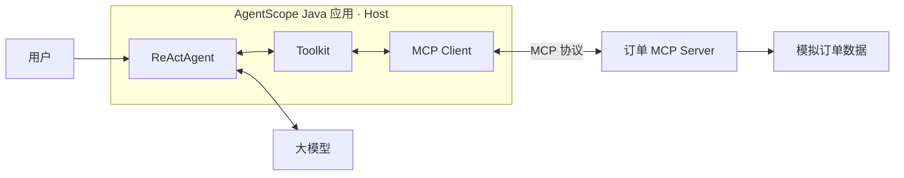
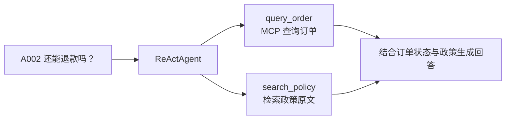

# MCP 

## 前言

MCP 可以让 Agent 通过统一协议接入外部工具和数据服务，AgentScope Java 也提供了对应集成。

我们用一个“查询订单”的案例，分四课学习：

| 顺序 | 学习内容 | 目标 |
|---|---|---|
| 1 | MCP 基本概念 | 理解 Client、Server，以及它和之前 `@Tool` 的关系 |
| 2 | 编写 MCP Server | 提供一个 `queryOrder(orderId)` 工具，先返回模拟数据 |
| 3 | AgentScope 接入 MCP | 让 Agent 根据用户问题选择工具、传入参数、组织回答 |
| 4 | RAG + MCP 综合案例 | 用知识库解释退款政策，用订单工具查询实际订单状态 |

例如用户问：
```text
我的订单 10001 还能退款吗？
```

我们希望 Agent 能查询订单状态，再结合知识库中的退款政策给出回答。

MCP（Model Context Protocol，模型上下文协议）约定了 AI 应用如何发现和调用外部工具。 比如：有哪些工具、每个工具接收什么参数、怎样调用、结果怎样返回。


先带着这个问题往下看：我们已经会用 `@Tool `了，为什么还需要 MCP？

先回到之前的 `@Tool`。

你在 `BaseExample.java` 中定义了：

```java
@Tool(name = "query_order", description = "根据订单号查询订单状态", readOnly = true)
public String queryOrder(
        @ToolParam(name = "orderId", description = "订单号，例如 A001")
        String orderId) {
    // 查询订单并返回结果
}
```
再把它注册进工具箱：

```java
toolkit.registerTool(new OrderTools());
```
这个例子中，订单工具就是当前 Java 程序里的一个对象。AgentScope 执行工具时，最终调用这个对象的 `queryOrder()` 方法。

```text
用户提问
   ↓
Agent 调用大模型，模型选择 query_order，并给出参数
   ↓
Toolkit 调用当前程序中的 Java 方法
   ↓
方法返回结果，Agent 再让模型组织回答
```

这里的工具代码和 Agent 代码放在同一个应用中，接入 MCP 后，订单工具可以由另一个程序提供。

我们计划让“订单 MCP Server”提供查询能力，你的 AgentScope 应用通过“MCP Client”访问它。官方所说的 Host、Client、Server，可以这样对应到我们的案例

| 角色 | 在我们的案例中 | 负责什么 |
|---|---|---|
| **Host，宿主应用** | 你编写的 AgentScope Java 应用 | 接收用户问题，协调模型和工具 |
| **Client，客户端** | 应用内部的 MCP 客户端组件 | 向 Server 请求工具列表、发送调用、接收结果 |
| **Server，服务端** | 我们下一课编写的订单工具程序 | 描述工具，执行订单查询，返回结果 |

我们准备搭建的结构是：




AgentScope 提供了将 MCP 工具注册进 Toolkit 的能力；本地源码中的注册过程会初始化客户端、获取工具列表，再包装并注册工具

一次查询，可以拆成“发现工具”和“执行工具”两个阶段。

假设用户问：
```text
帮我查一下订单 A001 发货了吗？
```

在我们的案例中，流程会是：
1. 发现工具：Client 通过 `tools/list` 获取 Server 提供的工具说明。
2. 模型选择：应用把工具名称、用途和参数结构提供给模型；模型根据问题提出调用 `query_order`，参数为 `{"orderId":"A001"}`。
3. 执行查询：Client 发送 `tools/call`，Server 执行订单查询并返回结果。
4. 生成回答：应用把结果交给模型，模型回答“你的订单 A001 已发货”。

工具列表通常在接入时获取，具体刷新方式由应用决定；上面两个阶段不意味着每次提问都要重新发现工具。

这里最需要分清的是：

```text
模型提出调用哪个工具、传什么参数；应用通过 Client 发出请求；Server 执行查询。
```
MCP 规定通信方式，工具选择仍由模型和应用的编排完成。

所以，`@Tool` 和 MCP 的关系是这样的

| 对比 | 之前的 `@Tool` 示例 | 我们接下来的 MCP 示例 |
|---|---|---|
| 工具在哪里 | 当前应用里的 Java 对象 | 订单 MCP Server 中 |
| 工具如何接入 | 注册带注解的对象 | Client 获取工具描述并注册 |
| 工具如何执行 | 调用本地 Java 方法 | 发送 MCP 请求，由 Server 执行 |
| 复用方式 | 复用 Java 代码或依赖 | 供协议兼容的 MCP 应用连接使用 |


### 为什么还需要 MCP

已经能用`@Tool`查询订单了，为什么还需要 MCP？

上次用“本地方法”和“另一个程序”帮助你区分。这里再精确一点：`@Tool` 标注的方法内部也可以调用远程接口；MCP 的主要价值是统一工具的描述、发现和调用方式。

假设你有一个订单系统，现在三个 AI 应用都想接入它：

- 你正在学习的 AgentScope 客服助手。
- 同事用 Python 编写的运营助手。
- 一个支持 MCP 的桌面 AI 应用。

如果分别对接订单系统，每个应用都需要处理订单接口的地址、请求参数、响应格式，并把它包装成模型能使用的工具。

采用 MCP 后，可以让一个“订单 MCP Server”负责对接订单系统。其他应用通过兼容的 MCP Client，使用同一套协议发现和调用它提供的工具。订单接口的适配逻辑，就可以集中在 Server 中。 这是基于 MCP 客户端与服务端结构的一种应用设计。

这里的“统一”，具体体现在三件事上。

第一，统一说明“我有什么工具”。

订单 Server 会提供一份工具说明。用自然语言表达，大致就是：

| 信息 | 订单查询工具的示例 |
|---|---|
| 工具名称 | `query_order` |
| 工具用途 | 根据订单号查询订单状态 |
| 参数名称 | `orderId` |
| 参数类型 | 字符串 |
| 是否必填 | 必填 |

这些信息对应 MCP 工具定义中的名称、描述和输入参数结构。Client 可以通过 `tools/list` 获取它们。

第二，统一表达“我要调用哪个工具”。

Client 按协议发送的含义是：

```text
请调用 query_order，订单号是 A001。
```

这种请求叫 `tools/call`。Server 收到后，执行自己的订单查询逻辑，再按协议返回结果。Client 使用工具名称和参数发起调用，无需直接调用 Server 内部的 Java 方法。

第三，让这些工具说明能够交给模型使用。

应用将工具说明提供给模型。用户问“A001 发货了吗”时，模型根据名称、描述和参数结构，提出调用订单查询工具；应用执行调用，再把查询结果交给模型组织回答。


## MCP Server

设计一个订单 MCP Server，让客户端能够发现并调用 `queryOrder(orderId)`。

我们先为这个练习确定一份工具规则：

| 项目 | 本案例的设计 |
|---|---|
| 对外工具名 | `query_order` |
| 工具描述 | 根据订单号查询订单状态和商品信息 |
| 输入参数 | `orderId`，字符串，必填 |
| 正常结果 | 订单号、商品名称、订单状态 |
| 订单不存在 | 明确返回“未查询到该订单” |
| 数据来源 | 先使用模拟数据 |

工具名称、描述和参数结构属于 MCP 的工具定义；其中，参数结构通过 `inputSchema` 表达。客户端获取工具列表时，会拿到这些信息。

开发这个`Server`，主要需要把“工具说明”和“执行逻辑”关联起来。

对于这个练习，业务逻辑可以先约定为：
- 查询 A001：返回“机械键盘，已发货”。
- 查询 A002：返回“无线鼠标，待发货”。
- 查询其他订单号：返回“未查询到该订单”。

这些模拟规则足够验证整条调用链，后面再把数据来源替换成订单数据库或业务接口。

然后，需要决定 Client 怎样连接这个 Server。

先认识两种方式：

| 方式 | 怎样运行和连接 | 适合的练习方式 |
|---|---|---|
| **stdio** | Client 启动 Server 子进程，通过标准输入、标准输出通信 | 在本机运行工具程序 |
| **Streamable HTTP** | Server 独立启动，Client 通过 HTTP 连接它的 MCP 入口 | 把工具作为一个独立服务运行 |

这两种都是 MCP 的标准传输方式。

### 依赖

首先添加依赖，当然mcp-server 只需要添加`mcp`的依赖就行了，但是为了项目管理方便一点，这里就直接使用`agentscope-java`

```xml
    <dependency>
      <groupId>io.modelcontextprotocol.sdk</groupId>
      <artifactId>mcp</artifactId>
      <version>${mcp.version}</version>
      <scope>compile</scope>
    </dependency>
```

### 服务类

```java

@Service
public class OrderServiceImpl implements OrderService {

    @Override
    public String queryOrderById(String orderId) {
        return switch (orderId) {
            case "A001" -> "订单 " + orderId + "：已发货，商品为机械键盘。";
            case "A002" -> "订单 " + orderId + "：待发货，商品为无线鼠标。";
            default -> "未查询到订单：" + orderId;
        };
    }
}
```
### 配置类
原生的`mcp`配置起来会比`springai`稍微繁琐一点。 
#### MCP Tool 定义
```java
@Bean
    public McpSchema.Tool queryOrderTool() {
        String inputSchema = """
                {
                  "type": "object",
                  "properties": {
                    "orderId": {
                      "type": "string",
                      "description": "订单号，例如 A001"
                    }
                  },
                  "required": ["orderId"],
                  "additionalProperties": false
                }
                """;

        return McpSchema.Tool.builder()
                .name("query_order")
                .description("根据订单号查询订单状态和商品信息")
                .inputSchema(McpJsonMapper.getDefault(), inputSchema)
                .build();
    }
```
理解这段代码，抓住三个地方：
- `name`：客户端调用时使用的工具名，我们约定为 `query_order`。
- `description`：说明工具用途，帮助模型选择工具。
- `inputSchema`：描述输入参数的结构，本例声明 `orderId` 是必填字符串。这些都属于工具定义的信息。

`McpJsonMapper.getDefault()` 获取 SDK 的默认 JSON 转换器，供 `inputSchema` 将 JSON 字符串解析成参数描述对象。

这段代码完成的是“工具说明”。
#### MCP Tool 处理
把工具说明和订单查询方法关联起来。 SDK 中的 SyncToolSpecification 用来组合“工具定义”和“调用处理函数”。

```java
@Bean
public McpServerFeatures.SyncToolSpecification queryOrderSpecification(
        McpSchema.Tool queryOrderTool,
        OrderService orderService) {

    return McpServerFeatures.SyncToolSpecification.builder()
            .tool(queryOrderTool)
            .callHandler((exchange, request) -> {
                // 1. 取出客户端传入的订单号
                Object rawOrderId = request.arguments() == null ? null : request.arguments().get("orderId");

                // 2. 检查订单号
                if (!(rawOrderId instanceof String orderId) || orderId.isBlank()) {
                    return McpSchema.CallToolResult.builder()
                            .addTextContent("orderId 必须是非空字符串")
                            .isError(true)
                            .build();
                }

                // 3. 调用你已经写好的业务方法
                String result = orderService.queryOrderById(orderId);

                // 4. 将业务结果包装成 MCP 工具结果
                return McpSchema.CallToolResult.builder()
                        .addTextContent(result)
                        .isError(false)
                        .build();
            })
            .build();
}
```

重点理解下面三处。
1. `.tool(queryOrderTool)`：绑定工具说明。它关联的就是你刚才创建的 query_order 工具定义。
2. `.callHandler(...)`：指定实际执行逻辑。回调里的 `request` 表示本次工具调用，`request.arguments()` 保存传入的参数。
3. `CallToolResult`：包装返回结果。`addTextContent(result)` 将字符串放入 MCP 的文本结果中；`isError(true)` 表示执行失败，`false` 表示执行成功。

#### MCP Server 定义
然后再创建 MCP Server，把这个 `queryOrderSpecification` 注册进去，并接通 HTTP 的 `/mcp` 入口。


创建 HTTP 传输组件。

```java
@Bean
public HttpServletStreamableServerTransportProvider mcpTransportProvider() {
    return HttpServletStreamableServerTransportProvider.builder()
            .jsonMapper(McpJsonMapper.getDefault())
            .mcpEndpoint("/mcp")
            .build();
}
```
第二步：创建 MCP Server，注册订单工具。
```java
@Bean(destroyMethod = "close")
public McpSyncServer mcpServer(
        HttpServletStreamableServerTransportProvider mcpTransportProvider,
        McpServerFeatures.SyncToolSpecification queryOrderSpecification) {

    return McpServer.sync(mcpTransportProvider)
            .serverInfo("order-mcp-server", "1.0.0")
            .capabilities(McpSchema.ServerCapabilities.builder()
                    .tools(false)
                    .build())
            .tools(queryOrderSpecification)
            .build();
}
```
如果需要多个`mcp tool`的话，就需要注册多个 `McpServerFeatures.SyncToolSpecification`，然后再将这些`tools`传进去。类似`.tools(orderTools, deliveryTools)`。


第三步：把传输组件映射到 `/mcp`。

```java
@Bean
@DependsOn("mcpServer")
public ServletRegistrationBean<HttpServletStreamableServerTransportProvider>
        mcpServletRegistration(
                HttpServletStreamableServerTransportProvider mcpTransportProvider) {

    ServletRegistrationBean<HttpServletStreamableServerTransportProvider> registration =
            new ServletRegistrationBean<>(mcpTransportProvider, "/mcp");

    registration.setName("mcpServlet");
    registration.setAsyncSupported(true);
    registration.setLoadOnStartup(1);

    return registration;
}
```

注意两个设置：
- `@DependsOn("mcpServer")`：确保先创建 MCP Server，再创建这个 Servlet 注册 Bean。
- `setAsyncSupported(true)`：开启 Servlet 异步请求支持，传输组件处理流式连接时会用到它。

这样组装后，我们设计的调用路径就是：

```text
MCP Client
    ↓ 请求 /mcp
HTTP 传输组件
    ↓
MCP Server
    ↓ 找到 query_order
queryOrderSpecification 中的回调
    ↓
OrderService.queryOrderById(orderId)
```

## MCP Client

OK，保持MCP Server 端启动。

```java
@Slf4j
public class McpClient {

    public static void main(String[] args) {
        McpClientWrapper client = McpClientBuilder.create("order-client")
                .streamableHttpTransport("http://127.0.0.1:9080/mcp")
                .buildSync();
        try (client) {
            // 1. 初始化连接
            client.initialize().block();
            // 2. 获取服务端提供的工具
            List<McpSchema.Tool> tools = client.listTools().block();
            for (McpSchema.Tool tool : tools) {
                System.out.println("工具：" + tool.name());
                System.out.println("说明：" + tool.description());
            }
            // 3. 调用订单查询工具
            Map<String, Object> mcpRequest = Map.of("orderId", "A001");
            McpSchema.CallToolResult result = client
                    .callTool("query_order", mcpRequest)
                    .block();
            log.info("isError = {}" ,result.isError());
            log.info("response: {}" , result);
        }
    }
}
```

| 操作 | 作用 |
|---|---|
| `initialize()` | 初始化客户端连接，必须在工具操作之前执行 |
| `listTools()` | 获取服务端提供的工具列表 |
| `callTool()` | 根据工具名和参数执行调用 |


验证通过后，我们就进入 AgentScope 的核心接入步骤：把这个 MCP Client 注册到 `Toolkit`，再交给 `ReActAgent` 根据用户问题选择工具和参数。


### ReActAgent 

把 MCP 工具接入 `ReActAgent`，让模型根据问题选择工具、填写参数，并整理结果。 AgentScope 通过 `Toolkit` 完成这层连接。


第一步：给订单工具（MCP Server）补一个只读标记

你使用的 AgentScope 2.0.3 会读取 MCP 工具的 `readOnlyHint`。只读工具可以直接执行；未声明只读的工具默认需要调用授权。你的订单查询只返回数据，适合声明为只读。

```java
@Bean
public McpSchema.Tool queryOrderTool() {
    String inputSchema = """
            {
              "type": "object",
              "properties": {
                "orderId": {
                  "type": "string",
                  "description": "订单号，例如 A001"
                }
              },
              "required": ["orderId"],
              "additionalProperties": false
            }
            """;

    return McpSchema.Tool.builder()
            .name("query_order")
            .description("根据订单号查询订单状态和商品信息")
            .inputSchema(McpJsonMapper.getDefault(), inputSchema)
            .annotations(new McpSchema.ToolAnnotations(
                    "订单查询",
                    true,   // readOnlyHint：只查询，不修改数据
                    null, null, null, null)
            )
            .build();
}
```

第二步 Agent 编写

核心操作是先注册 MCP 客户端，再将这个 `Toolkit` 交给 Agent。
```java
@Slf4j
public class McpAgentExample {

    public static void main(String[] args) {

        McpClientWrapper client = McpClientBuilder.create("order-client")
                .streamableHttpTransport("http://127.0.0.1:9080/mcp")
                .buildSync();

        Toolkit toolkit = new Toolkit();
        toolkit.registerMcpClient(client).block();

        OpenAIChatModel model = OpenAIChatModel.builder()
                .baseUrl("http://192.168.31.6:32354/v1")
                .modelName("qwen3.8-27b")
                .apiKey("")
                .stream(true)
                .build();

        ReActAgent agent = ReActAgent.builder()
                .name("order-assistant")
                .sysPrompt("""
                        你是一个订单查询助手，请使用中文回答。
                        查询订单状态时，必须调用订单查询工具。
                        用户没有提供订单号时，先询问订单号。
                        根据工具返回的真实结果回答，不要编造订单信息。
                        """)
                .model(model)
                .toolkit(toolkit)
                .build();

        try (agent; client) {
            Msg reply = agent.call(new UserMessage("帮我查一下订单 A001，发货了吗？")).block();
            log.info("助手回答：{}", Optional.ofNullable(reply).map(Msg::getTextContent).orElse(""));
        }
    }
}
```

重点理解这一行：`toolkit.registerMcpClient(client).block();`


它内部会初始化 MCP 客户端、获取工具列表、把工具包装并注册到 `Toolkit`。因此，这个示例中不用再单独写 `initialize()` 和 `listTools()`。

注册多个 MCP Client，分别连接不同的 MCP Server。
```java
Toolkit toolkit = new Toolkit();

// 注册订单服务的工具
toolkit.registerMcpClient(orderClient).block();

// 注册库存服务的工具
toolkit.registerMcpClient(inventoryClient).block();
```

之后，模型看到工具描述和参数结构，生成工具调用；AgentScope 通过 MCP 客户端执行，再把结果交回模型生成回答。真正发送 MCP 请求的是客户端，模型负责决定调用什么以及传什么参数。

### RAG MCP 

结合之前的`rag`，在加上 MCP 做一个 example 。订单A002还没有发货，是可以退货的，退货的政策在 `rag-persistant` 里。

我们把他定义成`tools`。

| 工具 | 提供的信息 | 接入方式 |
|---|---|---|
| `query_order` | 这个订单当前是什么状态 | 现有 MCP Server |
| `search_policy` | 哪些情况下可以申请退款 | 新增 AgentScope `@Tool` |


详情见 
[PolicyTool](./mcp-client/src/main/java/com/laoshiren/agent/mcp/tools/PolicyTool.java)
[RagMcpClient](./mcp-client/src/main/java/com/laoshiren/agent/mcp/RagMcpClient.java)

## 总结 

| 学习内容 | 目前进度 |
|---|---|
| MCP 基本概念 | 已讲：Client、Server、模型的职责，以及与 `@Tool` 的关系 |
| 编写 MCP Server | 已实现订单查询工具、参数定义、执行逻辑和服务入口 |
| AgentScope 接入 MCP | 已编写客户端，并将远程工具注册到 `Toolkit`，交给 `ReActAgent` 使用 |
| RAG + MCP 综合案例 | 已编写知识库检索工具，与订单工具组合使用；完整运行效果还需要验证 |

你现在已经接触了核心流程：

定义工具 → 发布 MCP 服务 → 客户端发现工具 → 注册到 AgentScope → 模型选择工具 → 执行并生成回答。
