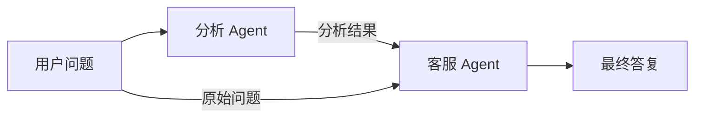
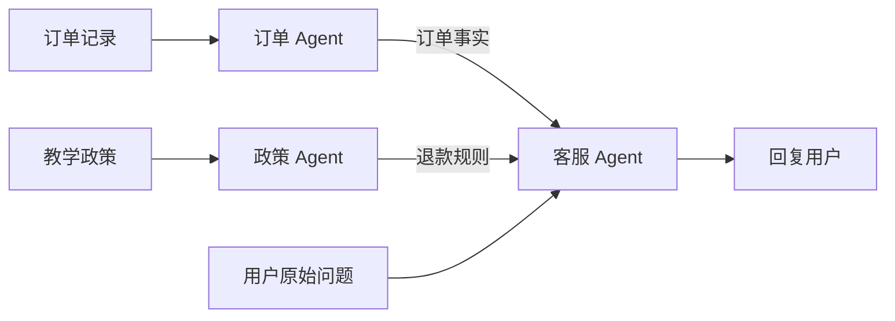

# Multi-agent


## 前言
Multi-agent（多智能体协作）就是：把一个任务拆给多个有明确职责的 Agent，并安排它们怎样交换信息。 两个 Agent 可以用同一个模型。拿售后举例，分析员负责判断“按政策能不能退”，客服负责把结论说给用户听。

为什么要拆？一个 Agent 也能回答退款问题。如果规则简单，一次调用就够了。拆成两个的价值，是你可以单独检查判断过程的结果：用户收到一句“可以退款”，你查看分析员的结论，就知道是分析员读错了政策，还是客服把“可以申请退货”说成了“可以直接退款”。代价是多一次调用，而且用户要等两步都完成。

| 顺序 | 学什么 | 用售后案例练什么 |
|---|---|---|
| 第 1 步 | **串行协作：把结果交给下一个 Agent** | 分析员先判断“订单 A001 能否退款”，Java 再把原始问题和分析结论交给客服，由客服组织回复。 |
| 第 2 步 | **并行协作：同时处理独立任务** | 一个 Agent 整理订单事实，另一个 Agent 整理退款政策。两者都返回后，客服结合两份结果作答。 |
| 第 3 步 | **任务路由：选择谁来处理** | “包裹到哪了”交给物流 Agent，“怎么开发票”交给发票 Agent。每次只调用需要的角色。 |
| 第 4 步 | **主管调度：决定下一步做什么** | 用户问“订单 A001 能退款吗”，主管根据已有结果决定继续查政策、向用户追问信息，还是结束并答复。 |


## 串行协作

多 Agent 可以按职责拆分任务。例如让一个 Agent 分析问题，另一个 Agent 根据分析组织回复，前一步的输出成为后一步的输入。



两个 Agent 分工如下：

| Agent | 职责 |
|---|---|
| `analyst` | 根据订单事实和政策判断，输出结论与依据 |
| `customer-service` | 根据分析结果，生成面向用户的简洁答复 |

```java
@Slf4j
public class SequentialAgentsExample {

    public static void main(String[] args) {
        // 两个 Agent 复用同一个模型连接配置。
        OpenAIChatModel model = OpenAIChatModel.builder()
                .baseUrl("http://192.168.31.6:32354/v1")
                .modelName("qwen3.8-27b")
                .apiKey("")
                .stream(false)
                .build();

        String question = "我的订单 A001 已经发货了，还能直接退款吗？";
        String runId = UUID.randomUUID().toString();

        ReActAgent analyst = ReActAgent.builder()
                .name("analyst")
                .model(model)
                .sysPrompt("""
                        你是售后分析员。
                        仅根据输入的订单事实和政策分析问题。
                        输出：
                        1. 处理结论
                        2. 判断依据
                        3. 缺失的信息
                        资料不足时明确说明，不补充未提供的规则。
                        你的输出供客服使用，无需直接回复用户。
                        """)
                .build();

        ReActAgent customerService = ReActAgent.builder()
                .name("customer-service")
                .model(model)
                .sysPrompt("""
                        你是售后客服。
                        根据用户原始问题和分析员提供的分析组织回复。
                        使用自然、简洁的中文，控制在三句话以内。
                        保留分析中的条件和不确定性，不添加新政策。
                        不声称已经执行退款或其他业务操作。
                        """)
                .build();

        try (analyst; customerService) {
            // 第一步：分析 Agent 根据明确提供的资料完成判断。
            String analysis = ask(analyst, """
                    用户问题：
                    %s
                    
                    订单事实：
                    订单 A001 已发货，尚未签收。
                    
                    教学演示政策：
                    - 未发货订单可以申请直接退款。
                    - 已发货订单不能直接退款，需要签收后按照退货流程申请。
                    - 以上资料没有说明退款到账时间。
                    """.formatted(question), runId + ":analysis");

            log.info("分析 Agent 输出： {}", analysis);

            // 第二步：把原问题和分析结果显式交给客服 Agent。
            String answer = ask(customerService, """
                    用户原始问题：
                    %s
                    
                    分析员结果：
                    %s
                    """.formatted(question, analysis), runId + ":reply");
            log.info("客服 Agent 输出： {}", answer);
        }
    }

    private static String ask(ReActAgent agent, String input, String sessionId) {
        RuntimeContext context = RuntimeContext.builder()
                .userId("multi-agent-student")
                .sessionId(sessionId)
                .build();
        Msg reply = agent.call(input, context).block(Duration.ofSeconds(120));

        if (reply == null || reply.getTextContent() == null || reply.getTextContent().isBlank()) {
            throw new IllegalStateException("Agent 没有返回有效文本");
        }
        return reply.getTextContent();
    }
}
```


```sql
15:25:37.679 [main] INFO com.laoshiren.agent.multiagent.SequentialAgentsExample -- 分析 Agent 输出： 

1. 处理结论  
订单 A001 目前不能直接退款。由于订单已发货，需待签收后按照退货流程申请处理。

2. 判断依据  
- 订单事实显示：订单 A001 已发货，尚未签收。  
- 教学演示政策规定：未发货订单可以申请直接退款；已发货订单不能直接退款，需要签收后按照退货流程申请。  
- 因此，当前订单状态不适用“直接退款”，应转为签收后的退货流程。

3. 缺失的信息  
现有资料未说明以下内容：  
- 退货流程的具体规则和入口。  
- 签收后申请退货的时限。  
- 退款到账时间。  
- 订单是否满足退货条件，例如商品完好、未使用等要求。
15:25:39.993 [main] INFO com.laoshiren.agent.multiagent.SequentialAgentsExample -- 客服 Agent 输出： 

您的订单 A001 已发货，目前不能直接退款。需要等您签收后，再按退货流程申请处理；具体入口、时限和是否满足退货条件，以实际页面说明为准。
```

## 并行协作

一个 Agent 开始工作前，需要另一个 Agent 的结果吗？

拿你的 A001 来说，订单 Agent 看订单记录，就能整理出“已发货、尚未签收”；政策 Agent 看教学政策，就能整理出“未发货可以直接申请退款，已发货需要签收后走退货流程”。它们互相不用等。客服要等，因为只有把订单状态和政策条件对上，才能回答“A001 能不能直接退”。

所以如果在主线程连续写两行 `ask(...)`，第二个调用一定要等第一个返回。我们保留这个方法，用 `CompletableFuture.supplyAsync` 分别提交两次调用，再用 `thenCombine` 在两份结果都成功返回后拼出客服的输入。

三个 Agent 仍按你上一节的方式创建，只改职责：`orderAgent` 只提取订单事实，`policyAgent` 只整理给定的政策，`customerService` 负责结合两者作答。


```java
@Slf4j
public class ParallelAgentsExample {

    public static void main(String[] args) {
        OpenAIChatModel model = OpenAIChatModel.builder()
                .baseUrl("http://192.168.31.6:32354/v1")
                .modelName("qwen3.8-27b")
                .apiKey("")
                .stream(false)
                .build();

        ReActAgent order = ReActAgent.builder()
                .name("order")
                .model(model)
                .sysPrompt("""
                        你是售后分析员。
                        仅根据输入的订单查询结果（随机给出已发货，未发货） 如果已发货 补充说明是否签收。
                        输出示例：
                        订单xxx 已发货，已签收。
                        订单xxx 已发货，未签收。
                        订单xxx 未发货。
                        """)
                .build();

        ReActAgent analyst = ReActAgent.builder()
                .name("analyst")
                .model(model)
                .sysPrompt("""
                        你是售后政策员。
                        - 未发货订单可以申请直接退款。
                        - 已发货订单不能直接退款，需要签收后按照退货流程申请。
                        - 以上资料没有说明退款到账时间。。
                        """)
                .build();

        ReActAgent customerService = ReActAgent.builder()
                .name("customer-service")
                .model(model)
                .sysPrompt("""
                        你是售后客服。
                        根据用户原始问题和分析员提供的分析组织回复。
                        使用自然、简洁的中文，控制在三句话以内。
                        保留分析中的条件和不确定性，不添加新政策。
                        不声称已经执行退款或其他业务操作。
                        """)
                .build();

        ExecutorService pool = Executors.newFixedThreadPool(2);


        String  userQuestion = "我的订单是 A0001 我能退货吗";

        try (order; analyst; customerService) {
            CompletableFuture<String> orderTask = CompletableFuture.supplyAsync(
                    () -> ask(order, userQuestion),
                    pool);

            CompletableFuture<String> policyTask = CompletableFuture.supplyAsync(
                    () -> ask(analyst, "退货退款政策"),
                    pool);

            String replyInput = orderTask.thenCombine(policyTask, (orderInfo, policy) -> """
                    用户原始问题：%s
                    订单事实：%s
                    退款政策：%s
                    """.formatted(userQuestion, orderInfo, policy)).join();

            ask(customerService, replyInput);
        } finally {
            pool.shutdown();
        }
    }


    private static String ask(ReActAgent agent, String input) {
        Msg reply = agent.call(input).block(Duration.ofSeconds(120));
        if (reply == null || reply.getTextContent() == null || reply.getTextContent().isBlank()) {
            throw new IllegalStateException("Agent 没有返回有效文本");
        }
        log.info("{}: {}",agent.getName(), reply.getTextContent());
        return reply.getTextContent();
    }

}
```

```text

```

## 任务路由

## 主管调度