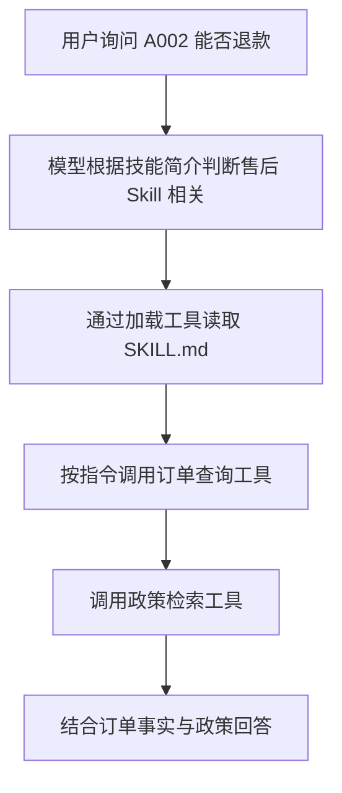

# SKILL 

## 前言

### 先说 Skill 是什么。

你可以把 Skill 理解成一份提供给 Agent 的“任务操作手册”。它描述某类任务的适用场景、处理步骤、判断规则，还可以附带参考资料、脚本和模板。标准的文件形式是一个目录，核心入口是 `SKILL.md`。

例如，我们准备设计一个“售后处理 Skill”，里面写：

```text
用户咨询具体订单能否退款时：
1. 检查用户是否提供订单号，没有就先询问。
2. 查询订单的实际状态。
3. 检索适用的退款政策。
4. 根据订单信息和政策判断，并说明依据。
5. 信息不足时，说明还缺什么，不能直接下结论。
```
这里描述的是我们希望 Agent 遵循的业务方法。

一个 `SKILL.md` 主要包含这几项：

| 内容 | 作用 | 售后案例 |
|---|---|---|
| `name` | 标识技能 | `after-sales` |
| `description` | 说明技能用途和使用时机 | 用户咨询订单退款、退货条件时使用 |
| Markdown 正文 | 说明具体怎么处理 | 获取订单号、查订单、检索政策、组织回答 |

注意，把“查询订单”写进 Skill，并不会自动产生查询订单的能力。Agent 仍然需要可用的订单查询工具。AgentScope 的处理方式是让 Agent 读取技能指令，再通过工具执行相应操作。

### 为什么需要 Skill，它解决什么问题。

之前已经在 `RagMcpClient` 的系统提示词里写过售后流程。对于我们这个只有一套简短流程的示例，这种写法完全可以继续使用。

现在假设业务增加了，助手需要处理：
- 退款、退货；
- 物流异常；
- 发票申请；
- 商品故障排查。

如果每种业务都有很多处理步骤，把它们全部放进系统提示词，会让这份提示词越来越长。不同助手要复用同一套流程时，还容易出现多份内容需要同步维护的问题。

Skill 提供了一种组织方式：把各类任务的方法分别打包，供兼容的 Agent 复用，并在任务相关时加载详细内容。它主要改善的是任务知识的组织、复用和按需加载。

在我们的设计中，可以这样划分：

| 放在哪里 | 准备放什么 |
|---|---|
| 系统提示词 | “你是售后助手，使用中文回答，不编造事实”等通用要求 |
| 售后 Skill | 处理退款、退货问题的具体步骤 |
| 物流 Skill | 处理物流异常的具体步骤 |
| 知识库 | 实际退款政策、物流规则等业务资料 |

这样，修改售后处理步骤时，我们就有一个明确的位置可以维护。


### 在 AgentScope Java 中怎么用 Skill。

先从开发者视角看，需要做三件事：

1. 准备技能内容：写好 SKILL.md，必要时附带参考资料。
2. 接入 AgentScope：通过框架的技能加载、注册机制，把技能提供给 ReActAgent。
3. 准备执行能力：把技能需要使用的工具接入 Agent，例如订单查询工具、政策检索工具。
   AgentScope 提供了技能仓库和技能内容加载机制，将这些内容与 Agent 的运行过程连接起来。(java.agentscope.io)

再从运行时看。假设用户问：

```text
我的订单 A002 还能退款吗？
```



这里需要区分两个动作：

- 发现技能：模型先看到技能名称和用途，知道有什么技能可用。
- 读取技能：需要使用时，通过 AgentScope 提供的 `load_skill_through_path` 工具，读取详细指令和相关资源。
  这就是按需加载的基本过程；技能简介帮助模型选择，详细正文指导后续处理。

其中，“先查订单，再检索政策”仍然是提供给模型的指令，不能当作 Java 代码中的强制执行顺序。后面的实验需要查看实际工具调用过程，确认模型是否读取了技能、是否按要求执行。

## 最小 SKILL

在 `skills` 模块里写第一份 [`SKILL.md`](./src/main/resources/skills/after-sales/SKILL.md)，让它教 Agent 处理一个情况：用户想退款，但没给订单号。

创建 `resources/skills/after-sales`。这里的 after-sales 是一个技能目录。资源放在这个位置，后面就可以用 AgentScope Java 的 `ClasspathSkillRepository` 读取。

这份文件里，简介和正文回答的是两个不同的问题：
- name 是技能名，与目录 `after-sales` 同名。`description` 告诉模型什么时候用：听到「这单的钱还能退吗？」就有理由考虑加载它。 
- 第二条 `---` 之后是正文，告诉模型选中以后怎么做：如果那句话里没有订单号，就先请用户提供订单号。正文是给模型的指令，写下它不会自动查订单。 


```java
@Slf4j
public class SkillRepositoryExample {

    public static void main(String[] args) {
        try (ClasspathSkillRepository repository =
                     new ClasspathSkillRepository("skills")) {
            AgentSkill skill = repository.getSkill("after-sales");

            log.info("名称：{}", skill.getName());
            log.info("简介：{}", skill.getDescription());
        } catch (IOException ignore) {

        }
    }
}
```

```text
10:16:54.264 [main] INFO io.agentscope.core.skill.repository.ClasspathSkillRepository -- Resource URL: file:/****/agent-scope-study/skills/target/classes/skills
10:16:54.266 [main] INFO io.agentscope.core.skill.repository.ClasspathSkillRepository -- is in Jar environment: false
10:16:54.299 [main] INFO com.laoshiren.agent.skills.SkillRepositoryExample -- 名称：after-sales
10:16:54.299 [main] INFO com.laoshiren.agent.skills.SkillRepositoryExample -- 简介：处理订单退款咨询。用户想退款，或询问某笔订单能否退款时使用。
```
运行时留意两个参数：`"skills"` 告诉仓库**去哪个资源目录找**，`"after-sales"`告诉仓库**取哪个技能**。打印出`after-sales` 和你在 `SKILL.md` 里写的简介

### SkillAgent

把 `after-sales` 接到 ReActAgent 后，模型会不会主动读取 `SKILL.md` 正文？ 先不接订单工具和政策检索，日志里只看技能加载。

[源码](./src/main/java/com/laoshiren/agent/skills/SkillAgentExample.java)
```java
ClasspathSkillRepository repository = new ClasspathSkillRepository("skills");
             ReActAgent agent = ReActAgent.builder()
                     .name("after-sales-assistant")
                     .sysPrompt("你是售后客服")
                     .model(model)
                     .skillRepository(repository)
                     .build();
             
             
             
agent.streamEvents(new UserMessage("我想退款，该怎么办？我的订单是A001"))
        .doOnNext(event -> {
            if (event instanceof ToolCallStartEvent call) {
                log.info("模型请求工具：{}" , call.getToolCallName());
            } else if (event instanceof ToolResultEndEvent result) {
                log.info("工具执行状态：{}" , result.getState());
            } else if (event instanceof AgentResultEvent result) {
                log.info("回复：{}" , result.getResult().getTextContent());
            }
        })
        .blockLast();
```

这次的关键是 `.skillRepository(repository)。` 上一次是在 Java 里主动调用 `getSkill("after-sales")；`。
这一节把仓库交给 AgentScope ，由框架把技能简介提供给模型。模型判断技能相关时，会请求 `load_skill_through_path` 来读取正文。系统提示词只写客服身份，这样你就不会把“先问订单号”这条规则同时写在两个地方。
日志如下
```text
11:22:47.038 [boundedElastic-2] INFO com.laoshiren.agent.skills.SkillAgentExample -- 模型请求工具：load_skill_through_path
11:22:47.197 [boundedElastic-2] INFO io.agentscope.core.skill.SkillToolFactory -- Activated skill: after-sales_classpath-skills
11:22:47.201 [boundedElastic-2] INFO com.laoshiren.agent.skills.SkillAgentExample -- 工具执行状态：SUCCESS
11:22:50.932 [boundedElastic-2] INFO com.laoshiren.agent.skills.SkillAgentExample -- 回复：

好的，已收到您的订单号 **A001**。

由于我目前还没有查询到该订单的状态和适用的退款政策，需要先核实一下订单的当前状态（例如是否已发货、签收情况等）以及对应的退款政策，才能判断是否可以为您办理退款。

麻烦您稍等，我先为您核实订单信息。另外，如果您方便的话，也可以先告诉我一下退款的原因，这样能帮我更快为您处理。
```

### SkillMCPAgent

上一次观察了模型是否读取技能；这次观察它读完 `after-sales` 后，是否会按照正文调用 MCP 的 `query_order`。即把MCP的能力也整合进来。

```java
// mcp tools
McpClientWrapper client = McpClientBuilder.create("order-client")
                .streamableHttpTransport("http://127.0.0.1:9080/mcp")
                .buildSync();

Toolkit toolkit = new Toolkit();
toolkit.registerMcpClient(client).block();


ReActAgent agent = ReActAgent.builder()
        .name("after-sales-assistant")
        .sysPrompt("你是售后客服")
        .model(model)
        .skillRepository(skillRepository)
        .toolkit(toolkit)
        .build();
```
日志
```text
11:27:43.573 [boundedElastic-1] INFO com.laoshiren.agent.skills.SkillMCPAgentExample -- 模型请求工具：load_skill_through_path
11:27:43.732 [boundedElastic-1] INFO com.laoshiren.agent.skills.SkillMCPAgentExample -- 模型请求工具：query_order
11:27:43.795 [boundedElastic-1] INFO io.agentscope.core.skill.SkillToolFactory -- Activated skill: after-sales_classpath-skills
11:27:43.810 [boundedElastic-4] INFO com.laoshiren.agent.skills.SkillMCPAgentExample -- 工具 load_skill_through_path 	执行状态：SUCCESS
11:27:43.810 [boundedElastic-4] INFO com.laoshiren.agent.skills.SkillMCPAgentExample -- 工具 query_order 	执行状态：SUCCESS
11:27:48.152 [boundedElastic-4] INFO com.laoshiren.agent.skills.SkillMCPAgentExample -- 回复：

您好！我已经查到您的订单 A001：商品为机械键盘，目前状态是**已发货**。

由于订单已发货，能否退款还需要进一步核实该订单适用的售后政策（如是否支持无理由退货、是否超过退货期限等）。请您先稍等，我核实后即可告知您是否可以退款以及具体的办理方式。
```

### SkillMCPRagAgent


接上 RAG 政策检索：订单 MCP 告诉 Agent「这笔订单是什么状态」，RAG 提供「适用的退款政策」，`SKILL.md` 告诉 Agent 怎么把这两份依据用起来。

```java
Toolkit toolkit = new Toolkit();
toolkit.registerTool(new PolicyTool());
            
ReActAgent agent = ReActAgent.builder()
   .name("after-sales-assistant")
   .sysPrompt("你是售后客服")
   .model(model)
   .skillRepository(skillRepository)
   .toolkit(toolkit)
   .build();
```
日志
```text
11:31:44.309 [boundedElastic-1] INFO com.laoshiren.agent.skills.SkillMCPRagAgentExample -- 模型请求工具：load_skill_through_path
11:31:44.455 [boundedElastic-1] INFO io.agentscope.core.skill.SkillToolFactory -- Activated skill: after-sales_classpath-skills
11:31:44.459 [boundedElastic-1] INFO com.laoshiren.agent.skills.SkillMCPRagAgentExample -- 工具 load_skill_through_path 	执行状态：SUCCESS
11:31:47.037 [boundedElastic-1] INFO com.laoshiren.agent.skills.SkillMCPRagAgentExample -- 模型请求工具：query_order
11:31:47.142 [boundedElastic-3] INFO com.laoshiren.agent.skills.SkillMCPRagAgentExample -- 工具 query_order 	执行状态：SUCCESS
11:31:47.845 [boundedElastic-3] INFO com.laoshiren.agent.skills.SkillMCPRagAgentExample -- 模型请求工具：search_policy
11:31:48.494 [boundedElastic-2] INFO com.laoshiren.agent.skills.tools.PolicyTool -- rag: [{"id":245,"documentId":2122608273751908354,"documentVersion":1,"chunkNo":0,"title":"退款","content":"# 售后政策\n\n## 退款\n未发货订单可以申请退款，申请时需要提供订单号。","sourceUri":"upload:after-sales.md","sourceLocator":{"line_end":4,"line_start":1,"section_path":["售后政策","退款"]},"metadata":{"chunking":"markdown-atx-char-v1","filename":"after-sales.md"},"score":0.7528633776740767},{"id":246,"documentId":2122608273751908354,"documentVersion":1,"chunkNo":1,"title":"退货","content":"## 退货\n已签收商品可以在七天内申请退货，商品须保持完好。","sourceUri":"upload:after-sales.md","sourceLocator":{"line_end":7,"line_start":6,"section_path":["售后政策","退货"]},"metadata":{"chunking":"markdown-atx-char-v1","filename":"after-sales.md"},"score":0.6042937885031368},{"id":247,"documentId":2122608273751908354,"documentVersion":1,"chunkNo":2,"title":"发票","content":"## 发票\n订单完成后可以申请电子发票，申请时需要提供发票抬头。","sourceUri":"upload:after-sales.md","sourceLocator":{"line_end":10,"line_start":9,"section_path":["售后政策","发票"]},"metadata":{"chunking":"markdown-atx-char-v1","filename":"after-sales.md"},"score":0.5425915112646468}]
11:31:48.495 [boundedElastic-2] INFO com.laoshiren.agent.skills.SkillMCPRagAgentExample -- 工具 search_policy 	执行状态：SUCCESS
11:31:50.321 [boundedElastic-2] INFO com.laoshiren.agent.skills.SkillMCPRagAgentExample -- 回复：

您好，我已经帮您核实了订单和售后政策，结果如下：

**订单 A002**
- 商品：无线鼠标
- 状态：**待发货**

**退款政策**
根据售后政策：未发货订单可以申请退款，申请时需要提供订单号。

**结论**：您的订单尚未发货，符合退款条件 ✅

您可以直接凭订单号 **A002** 提交退款申请。如果您需要，我可以协助您进一步办理退款，请告诉我您的具体需求。
```

## 个人技能

同一个应用服务，怎么让不同用户用上各自的 Skill。


每次请求决定 Agent 能看到哪些 Skill

之前用 `ClasspathSkillRepository("skills")` ，技能来自项目的资源目录，用户看到的是同一套技能。现在，Alice 和 Bob 都可以有一个叫 `after-sales` 的技能，但正文不同

| 用户 | 同样问「我想退款」时，自己的 Skill 怎么指导 Agent |
|---|---|
| Alice | 先询问订单号 |
| Bob | 先询问订单号和退款原因 |

这里有两个动作：服务端按用户选择可见的技能，模型再按问题决定要不要读取技能正文。


### 为什么需要这个 

如果 Skills 仅仅是全局共享的静态代码，它就退化成了传统的微服务接口。将 Skills 设计为支持个人化，能让 Agent 从“通用工具”升级为“专属助理”，这也是目前 Agent 架构演进的核心方向。

如果所有人的售后流程都一样，现有的 SKILL.md 就够用。
如果每个人都能修改自己的处理步骤，就可以把个人版本存到 `personal_skill` 表。
Bob 调整自己的退款问询步骤后，后续请求查到的就是 Bob 的新版本，Alice 的版本不受影响，也不需要重新打包应用。

`personal_skill` 是你的业务表。谁能读哪条记录，由 Web 服务根据登录身份决定。 给模型的技能清单里，只放当前用户有权使用的技能。

详情见[general-skill](./../general-skills/README.md)


